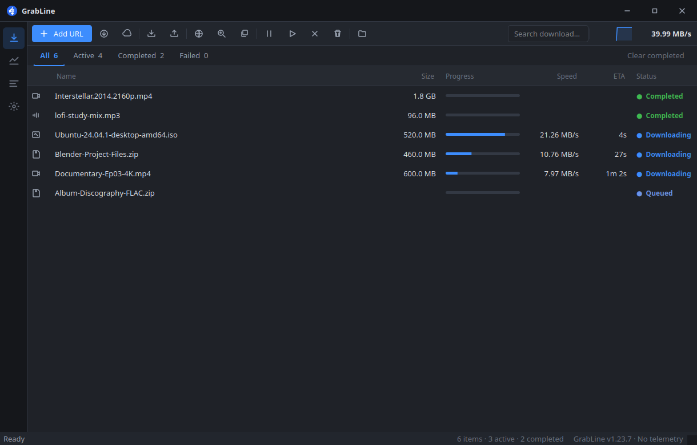
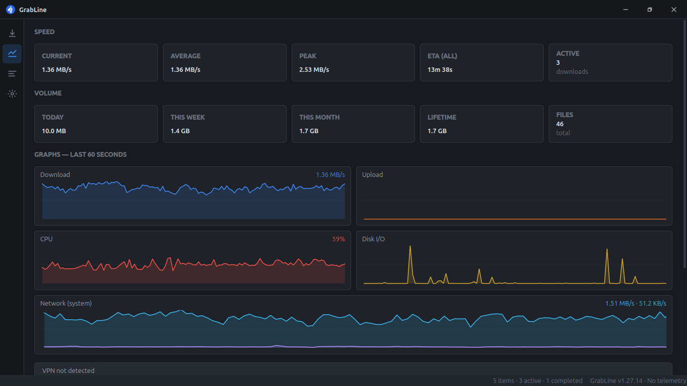
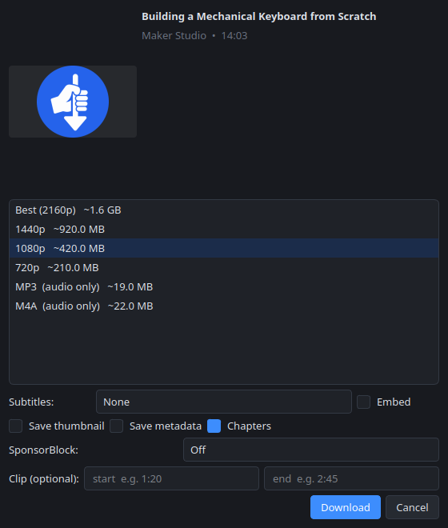

<div align="center">


# GrabLine

**Downloads, media, torrents and cloud files in one desktop app.**

Free and open source for Windows, macOS and Linux. No ads, account or usage telemetry.

[![Download][download-badge]][releases]
[![CI][ci-badge]][ci]
[![License: AGPL-3.0-or-later][license-badge]][license]
[![Firefox add-on][amo-badge]][amo]

**[Download][releases] · [Website][website] · [Documentation](docs/README.md) · [Report a bug][issues]**



</div>

Paste a URL, drop a link onto the window, or send it from **GrabLine Connect**.
Use one queue for ordinary files, video and audio, magnets, torrent files and
authenticated cloud transfers. Media quality and conversion choices appear in
the desktop app before the download starts.

## Download

Get the installers and extension packages from the **[latest release][releases]**.
Packaged desktop builds do not require Python.

| Platform | Recommended package | Alternative |
| --- | --- | --- |
| Windows x64 | `Grabline-Setup-<version>.exe` | `Grabline-<version>-windows-portable.zip` |
| macOS, Apple Silicon | `Grabline-<version>-applesilicon.dmg` | Build from source for other configurations |
| Linux x86-64 | `grabline_<version>_amd64.deb` | AppImage or tarball |

Builds are currently unsigned. See the [installation guide](docs/install.md) for
package verification, first launch, browser pairing and data locations. FFmpeg
and Deno are downloaded separately when needed; RAR/7Z extraction needs 7-Zip.

## Features

| Area | What you can do |
| --- | --- |
| File downloads | Use up to 32 HTTP connections per file, resume partial transfers, retry and use mirrors. |
| Video and audio | Choose formats through yt-dlp; download playlists, subtitles and chapters; trim or convert media with FFmpeg. Site availability and available qualities depend on the source. |
| Browser integration | Send links, hover over media, collect images or links, inspect detected streams and optionally hand browser downloads to GrabLine. Native Messaging connects the extension to the app. |
| Torrents | Add magnets, `.torrent` files, batches, RSS feeds and watch folders; configure seeding and connection limits. |
| Cloud protocols | Use FTP/FTPS, SFTP/SCP URLs, WebDAV and S3-compatible services; save account secrets in the OS keyring. Public Drive/Dropbox share links have dedicated handling. |
| Queues and schedules | Set named queues, priorities, dependencies, concurrency, time windows and bandwidth limits. |
| File management | Use categories, search, tags/notes, naming rules, archive extraction and history import/export. |
| Desktop controls | Configure tray behaviour, shortcuts, themes, notifications, completion commands and queue-finished actions. |
| Security tools | Inspect checksums and optional scanner/reputation results. TLS verification and archive path checks protect the download pipeline. |

### A closer look

<table>
  <tr>
    <td width="60%" valign="top"><br /><sub>Transfer dashboard</sub></td>
    <td width="40%" valign="top"><br /><sub>Media quality picker</sub></td>
  </tr>
</table>

## Browser companion

- **Firefox:** install [GrabLine Connect from Mozilla Add-ons][amo].
- **Chrome, Edge and other Chromium browsers:** follow the app's **Browser Setup**
  instructions to load the unpacked extension. For development, use this repo's
  `extension/` folder so the pinned extension identity matches the native host.
- Launch GrabLine, pair the browser and open the extension popup to check the
  connection. [Extension setup and behaviour](extension/README.md) explains the
  difference between an unpaired host and an app that is closed.

The extension communicates over local stdio pipes, with no listening web server.
GrabLine opens no network port except the optional phone-remote listener, which
is off until you pair a phone and listens only on your local network. See the
[security model](docs/security-model.md#phone-remote-listener).
Download takeover can be disabled in its popup. Generated browser files and POST
exports stay in the browser; Firefox and Chromium use different takeover paths.

## Documentation

| Start here | Details |
| --- | --- |
| [Install and update](docs/install.md) | Packages, checksums, pairing, backups and uninstall |
| [Using GrabLine](docs/usage.md) | Downloads, media, queues and all 19 settings sections |
| [Troubleshooting](docs/troubleshooting.md) | Pairing, failed transfers, tools, logs and bug reports |
| [Contributing](CONTRIBUTING.md) | Development setup, checks and pull requests |
| [Windows development](docs/windows-development.md) | PowerShell setup and isolated Windows testing |
| [Testing and coverage](docs/testing.md) | Reproduction commands, evidence and known coverage limits |
| [Architecture and learning](docs/learn-grabline.md) | Trace a URL through the app and browser bridge |
| [Release notes](docs/releases/README.md) | Current changes and historical notes |

The [documentation index](docs/README.md) also links packaging, performance,
security, privacy and store-publishing references.

## Run from source

Use **Python 3.12** to match CI. See [Contributing](CONTRIBUTING.md) for Linux
system libraries and additional development tools.

**Windows PowerShell**

```powershell
git clone https://github.com/GrabLine/GrabLine.git
Set-Location GrabLine
py -3.12 -m venv .venv
.\.venv\Scripts\python.exe -m pip install -e ".[dev]"
.\.venv\Scripts\python.exe -m app
```

**Linux / macOS**

```sh
git clone https://github.com/GrabLine/GrabLine.git
cd GrabLine
python3.12 -m venv .venv
. .venv/bin/activate
python -m pip install -e ".[dev]"
python -m app
```

## Privacy and limits

GrabLine has no usage analytics or author-operated download service. Downloads,
update checks, tool provisioning and enabled integrations contact their respective
services. Browser sessions and handed-off request headers may contain sensitive
data; see the [privacy policy](PRIVACY.md) before sharing logs or backups.

GrabLine does not bypass DRM or account access restrictions. Only download
content you are entitled to access. Local test coverage does not certify every
yt-dlp site, private cloud provider or hardware-dependent action; the
[testing guide](docs/testing.md) records those limits.

## Support and license

[Report a reproducible issue][issues], contribute a fix, or
[support development on Ko-fi][support]. Report exploitable vulnerabilities
privately through [the security policy](SECURITY.md).

Licensed under [AGPL-3.0-or-later][license]. Dependency licenses remain their
own; FFmpeg and Deno are provisioned separately rather than bundled in installers.

[releases]: https://github.com/GrabLine/GrabLine/releases/latest
[website]: https://grabline.github.io/
[issues]: https://github.com/GrabLine/GrabLine/issues
[amo]: https://addons.mozilla.org/en-US/firefox/addon/grabline-connect/
[support]: https://ko-fi.com/zain021xd
[license]: LICENSE
[ci]: https://github.com/GrabLine/GrabLine/actions/workflows/ci.yml
[download-badge]: https://img.shields.io/github/v/release/GrabLine/GrabLine?label=download&color=2563EB
[ci-badge]: https://img.shields.io/github/actions/workflow/status/GrabLine/GrabLine/ci.yml?branch=main&label=CI
[license-badge]: https://img.shields.io/badge/license-AGPL--3.0--or--later-blue
[amo-badge]: https://img.shields.io/amo/v/grabline-connect?label=Firefox&color=ff7139
