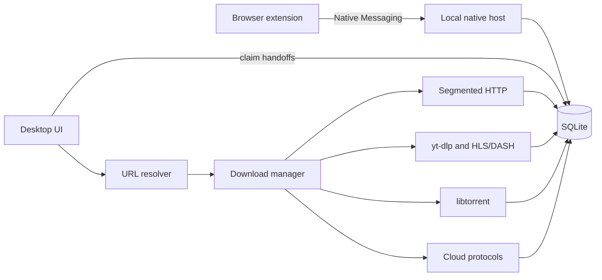

# GrabLine architecture and learning path

Use this walkthrough alongside [Contributing](../CONTRIBUTING.md) and
[Testing](testing.md). The paths below refer to the current source layout;
tests and implementation are the final reference for behaviour.

## Start with one download

GrabLine is a PySide6 desktop app coordinating several transfer engines around
a SQLite database. The browser companion sends validated handoffs to the same
pipeline used by pasted URLs. It does not expose a localhost web service.



Read [app/__main__.py](../app/__main__.py), then trace a URL through
[main_window.py](../app/ui/main_window.py), [resolver.py](../app/core/resolver.py)
and [manager.py](../app/core/manager.py). Explain which object owns each step,
where work leaves the GUI thread, and when state is persisted.

## Source map

| Area | Start reading | Question to answer |
| --- | --- | --- |
| Entry point and paths | [app/__main__.py](../app/__main__.py), [paths.py](../app/core/paths.py), [instance.py](../app/core/instance.py) | What starts, where is data stored, and what happens on a second launch? |
| Models and database | [models.py](../app/core/models.py), [database.py](../app/db/database.py) | How do jobs, segments and handoffs survive restart? |
| URL routing | [resolver.py](../app/core/resolver.py), [cloudlinks.py](../app/core/cloudlinks.py) | Which engine owns a URL, and what is refused? |
| Direct HTTP | [probe.py](../app/core/probe.py), [downloader.py](../app/core/downloader.py), [ratelimit.py](../app/core/ratelimit.py) | How do ranges, checkpoints and rate limits interact? |
| Scheduling | [manager.py](../app/core/manager.py) | What gates a queued job: concurrency, schedule, dependency or network state? |
| Smart media | [smart.py](../app/engines/smart.py), [quality_panel.py](../app/ui/quality_panel.py) | How do inspection, session/runtime preparation and download differ? |
| Stream manifests | [manifest.py](../app/engines/manifest.py), [hls.py](../app/engines/hls.py) | How are segments fetched, validated and remuxed? |
| Torrents | [torrent.py](../app/engines/torrent.py) | How are session state, metadata and file completion mapped to a job? |
| Cloud | [cloud.py](../app/engines/cloud.py), [credentials.py](../app/core/credentials.py) | How are account identity, secrets and resume validators handled? |
| Browser bridge | [protocol.py](../app/native_host/protocol.py), [host.py](../app/native_host/host.py), [extension guide](../extension/README.md) | What is trusted, validated and stored before the app sees a URL? |
| UI and settings | [main_window.py](../app/ui/main_window.py), [settings_dialog.py](../app/ui/settings_dialog.py), [settings.py](../app/core/settings.py) | Which work belongs on the GUI thread and which values need restart? |
| Packaging | [packaging guide](../packaging/README.md), [release workflow](../.github/workflows/release.yml) | Why are GUI and native-host executables separate? |

## Suggested study sequence

### 1. Boot and persistence

Run the app from a development environment. Read the database schema and model
enums, then run `python -m pytest app/tests/test_db.py`. Sketch the relationship
between a job, its segments and an unclaimed browser handoff. Use a disposable
database for experiments; never open the personal database to practice writes.

### 2. Resolver and direct transfer

Read the resolver tests and predict routing for an ordinary file, media page,
magnet and cloud URL. Run the focused tests:

```sh
python -m pytest app/tests/test_resolver.py app/tests/test_downloader.py -m 'not network'
```

Find where `Content-Range` is checked, resource identity is retained, partial
progress is checkpointed and the final name is reserved. Explain why a file that
changed on the server cannot safely append to an old partial.

### 3. Scheduling and media

Trace one queued job through the manager. Distinguish pause from cancel and
resource failure from a transient retry. Then trace a media URL through analysis,
quality selection, download and FFmpeg output. Identify the code that scopes
browser credentials to the approved origin. Do not assume an optional UI control
exists merely because an old settings key remains in the database.

### 4. Extension and native host

Read the [extension guide](../extension/README.md), inspect `background.js` and
one site module, then follow a length-prefixed message into SQLite. Explain why
Windows needs a console native-host binary alongside its windowed GUI. Compare
an explicit handoff with automatic takeover and the Chromium browser fallback.

### 5. UI, privacy and security

Read [the security model](security-model.md) and [privacy policy](../PRIVACY.md).
Find the GUI/background-worker boundary, shutdown order, archive path checks,
TLS policy and export sanitization. Explain advisory content warnings versus
enforced application-integrity checks. Read the relevant tests before editing.

### 6. Verification and publication

Use [Testing](testing.md) for isolated checks. Read all four workflows in
[.github/workflows](../.github/workflows) and explain which events run CI,
deploy Pages, publish the informational package and create installers.

Current branch history is ordinary Git history:

```text
topic change → reviewed dev commit → normal merge/fast-forward to main
  → CI and Pages
  → a new version tag, only when releasing → native builds and publication
```

Never recreate or force-push an orphan `main`. Never move an existing published
tag. The owner currently retains only the newest release/tag; see
[RELEASING.md](../RELEASING.md) for verification and cleanup policy.

## Practice projects

Build these outside this checkout, with synthetic inputs:

1. A one-connection downloader with a partial file and resume validator.
2. A range downloader with checkpointed segments and a final hash assertion.
3. A small Qt view reading job state without blocking its GUI thread.
4. A URL router choosing direct, media, torrent and cloud transports.
5. A native-message decoder rejecting malformed lengths, fields and schemes.
6. A local media pipeline validated with FFprobe and a cancellation case.
7. A frozen Qt bundle with separate GUI and stdio-host entry points.

Finish by explaining one browser click through to a verified final file, naming
the thread/process boundaries, trust checks and persisted state along the way.
